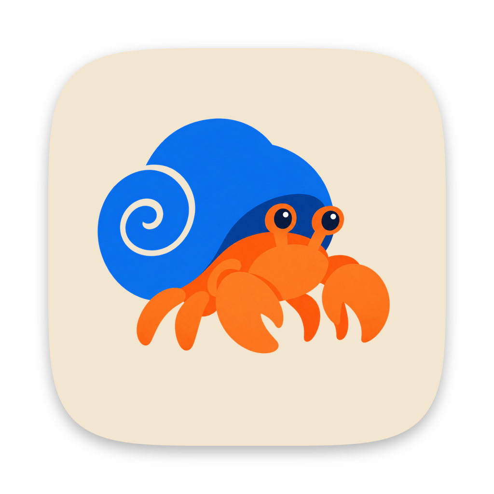

# Hermit Crab

A quiet, Markdown-based writing app for the desktop, iPhone and iPad, in the spirit of Ulysses. Built with Electron, Capacitor, React and CodeMirror 6.

## Features

- **Projects and sheets.** The library sidebar holds your projects, which you can group into folders nested as deep as you like. The middle column lists the sheets in the selected project. A sheet's first line becomes its title, and the text after it becomes the excerpt.
- **Content and notes.** Each project has two sections. The content is the work itself: it's what gets exported and counted. Notes are for planning, outlines and research. Switch between the sections at the top of the sheet list; each remembers the sheet you last had open.
- **Canvases.** Notes can also be canvases: open boards, like Obsidian's, for planning visually. Add Markdown cards (double-click anywhere), headings, linked notes and sheets that show their text, and images (from the toolbar, by dropping files, or by pasting). Drag from the dot on a card's edge to connect it to another, or onto empty space to start a new connected card. Colour cards and connections, label connections, and pan (drag or scroll) and zoom (⌘-scroll or pinch). Drag notes in from the sheet list to link them. Canvases are saved in the open [JSON Canvas](https://jsoncanvas.org) format, so other apps can read them too.
- **Subsections.** Either section can be organised into subsections, such as parts and chapters, or characters and research. Subsections nest as deep as you like, and sit in order among the sheets around them.
- **Archives.** Archive what you're done with but want to keep. Right-click a project and choose **Archive**, or drag it onto the Archive section at the bottom of the library. Within a project, right-click a sheet, note or subsection to archive it, or drag it onto the **Archive** tab beside Content and Notes. Archived sheets leave the outline, the word counts and exports, but stay searchable and readable in the Archive tab. **Restore** puts anything back where it came from, remaking its folder or subsection if it's gone.
- **Plain files on disk.** A library is just a folder (default `~/Documents/Hermit Crab`). Each project is a sub-folder and each sheet is a `.md` file. A folder of projects is a sub-folder marked by a hidden `.hermit-folder` file. Notes go in the project's `Notes` sub-folder, and each subsection is a folder. A canvas is a `.canvas` file named after the canvas. Its links point at files by their path within the project, and images placed on a canvas are copied into the project's `Attachments` folder. Archived sheets move to the project's hidden `.archive` folder, keeping their path so they can go back (`.archive/Notes/…`). Archived projects move to a hidden `.archive` folder at the top of the library, inside the same folders they were in. Sheet and subsection order is kept in a small hidden `.hermit.json`. Markdown files and folders you add to a project folder show up as sheets and subsections.
- **Screenplays.** In a project's settings (the sliders button above the sheet list, the project's right-click menu, or **File → Project Settings…**), set the content type to Screenplay to write the content in [Fountain](https://fountain.io), the plain-text format for scripts. You don't need to know Fountain to write one: as in a screenwriting app, **Tab** changes the current line between action, character, transition and scene heading (or, under a name, between dialogue and parenthetical), and **Enter** moves on to what usually comes next — a name to its dialogue, dialogue back to action. Scene headings and names are capitalised as you type, and the status bar shows the current element and can change it. Choose an element from **Format → Screenplay Element** (⌥⌘1–6) too, or, on iPhone and iPad, from the bar above the keyboard. **Shift-Enter** is a plain line break. Fountain written by hand works as before; any marks a line needs, such as `@` for a name in mixed case, are written for you and kept out of sight. Scripts are laid out as you type, preview as a formatted screenplay, and export as Fountain, or as HTML or PDF in standard screenplay layout. Notes stay Markdown. Project settings are kept in the project's `.hermit.json`, so they sync with it.
- **Markdown editor.** Syntax stays visible but fades into the background. Headings, emphasis, links, quotes and code are styled inline, and fenced code blocks get syntax highlighting.
- **Autosave.** Edits are written atomically shortly after you stop typing, and flushed before the window closes or the app quits.
- **Writing modes.** Focus mode dims everything except the current paragraph. Typewriter mode keeps the caret line centred.
- **Preview** of the rendered Markdown.
- **Organise.** Drag sheets and subsections to reorder them, or drop one onto a subsection to put it inside, or onto the other section's tab to move it between content and notes. Drop a sheet onto another project to move it there, and drag projects and folders in the sidebar onto a folder to file them inside. Right-click projects and sheets for more options. Search a project by full text.
- **Export** a sheet or a whole project as Markdown, HTML or PDF. A project exports its content, with sheets joined in order.
- **Themes.** Follow the system's light or dark appearance, pick a preset (Sepia, Rosé, Midnight, Forest…), or build your own in **Settings** by choosing background and text colours from a palette or any custom colour. Colours you save are kept for reuse.
- **GitHub sync.** In **Settings → Sync**, connect the library to a GitHub repository. Hermit Crab commits and pushes shortly after you pause writing, pulls on a timer and whenever you return to the app, and reloads open sheets in place. It uses your own `git`, so any repository you can already push to works. When the same sheet changed in both places, a merge editor lets you pick a side per conflict or edit the result. Claude Code or Codex, running locally, can take a first pass, and you review its changes before they're synced.
- **Grammar checking.** Grammar, word choice and punctuation are checked as you type by [Harper](https://writewithharper.com), which runs entirely on your computer. Hover over an underline for suggestions, or ignore it. Pick your English dialect or turn checking off in **Settings → Writing**.
- Live word count, character count and reading time; spellcheck with suggestions; adjustable editor font and size.

## iPhone and iPad

The iOS app is the same app, with the same library on disk, made for touch.

- **On iPhone**, the library, the sheet list and the editor are screens of their own: tap a project to see its sheets, a sheet to write in it, and the back button to return. **On iPad**, the panes sit side by side, as on the Mac; a narrow iPad starts with the library hidden.
- **Touch and hold** a project, folder, sheet or subsection for what the Mac shows on right-click. Instead of dragging, choose **Move Up**, **Move Down**, **Move to…** or **Move to Folder…**.
- While writing, a bar above the keyboard adds headings, bold, italic, links, quotes and code, and undoes. In a screenplay, it picks the element instead: scene heading, action, character, parenthetical, dialogue or transition. Tap an underlined word to see grammar suggestions.
- The **⋯** button at the top of the editor has find, focus and typewriter modes, the font and text size, export, project settings and settings.
- Canvases pan with a finger, zoom with a pinch, and add a card with a double-tap.
- **Exports** go to the share sheet, from which you can save them to Files, send them, or open them in another app.
- **Library location.** The library starts in the app's own folder, which the Files app shows as **On My iPhone › Hermit Crab**. In **Settings → Library**, choose a folder instead, such as one in iCloud Drive. To share a library with your Mac through iCloud, choose the same iCloud Drive folder in Hermit Crab on both.
- **GitHub sync** works as on the Mac, signing in with a [fine-grained personal access token](https://github.com/settings/personal-access-tokens) that can read and write the repository's contents. The token is kept in the keychain. The repository's `.git` folder lives in the app's private storage rather than in the library, so a library shared through iCloud is never written to by two copies of git. Conflicts open in the same merge editor; the Claude Code and Codex helpers are only on the Mac. When the app first joins a repository that already has writing in it, it leaves its welcome project behind, unless you've written in it.
- With a keyboard attached to an iPad, the Mac's shortcuts work too.

## Shortcuts

| Action | macOS |
| --- | --- |
| New sheet / canvas / project | ⌘N / ⌥⌘N / ⇧⌘N |
| Bold / italic / code / link | ⌘B / ⌘I / ⌘E / ⌘K |
| Cycle heading / toggle quote | ⌥⌘H / ⌥⌘' |
| Screenplay: next element / scene heading … transition | Tab / ⌥⌘1 … ⌥⌘6 |
| Find in sheet | ⌘F |
| Next grammar issue / list all issues | F8 / ⇧⌘M |
| Previous / next sheet | ⌥⌘↑ / ⌥⌘↓ |
| Toggle library / sheet list | ⌘1 / ⌘2 |
| Switch content / notes | ⌘3 |
| Hide / show both sidebars | ⌘\ |
| Preview / focus / typewriter | ⇧⌘P / ⇧⌘F / ⇧⌘T |
| Text size | ⌘+ / ⌘- / ⌘0 |
| Export sheet | ⇧⌘E |
| Settings | ⌘, |
| Sync now | ⌥⌘S |

On Windows and Linux, use Ctrl in place of ⌘.

## Development

Use pnpm 12.8.1, the version pinned in `package.json`. See the [pnpm installation instructions](https://pnpm.io/installation) if it is not installed.

```sh
pnpm install
pnpm dev        # run with hot reload
pnpm typecheck
pnpm build      # production build into out/
pnpm package    # distributable via electron-builder into dist/
```

Dependencies use a hoisted layout, configured in `pnpm-workspace.yaml`, for Electron packaging compatibility. Commit changes to `pnpm-lock.yaml` when adding or updating dependencies; use `pnpm install --frozen-lockfile` for reproducible installs.

The `dev` and `preview` commands download the Electron executable if it is missing. The first run may take longer; later runs reuse the installed executable.

Set `HERMIT_LIBRARY=/some/folder` to point the app at a different library (handy for testing). You can also change the library from **File → Change Library Location…**.

### iOS

The iOS app needs Xcode 26 or later. Capacitor wraps the renderer in a native app, and Swift Package Manager fetches the native dependencies the first time Xcode builds it.

```sh
pnpm ios:build  # build the web app into out/mobile and copy it into the Xcode project
pnpm ios:open   # open ios/App in Xcode, then pick a simulator or device and Run
```

To run on a device, choose your team under **Signing & Capabilities** in Xcode. Run `pnpm ios:build` again after changing anything under `src/`. `npx electron scripts/ios-icons.cjs` rebuilds the app icons from `assets/hermit-crab-foreground.png`.

### Layout

```
src/
  main/       Electron main process: window, menus, IPC, Node file access, export and git sync
  preload/    contextBridge API exposed to the renderer as window.hermit
  renderer/   React UI and CodeMirror editor, shared by the desktop and iOS apps
  mobile/     The iOS app's window.hermit: library, menus, export and sync (isomorphic-git), all in the page
  shared/     The library, sync and export logic, types and text helpers used by both apps
ios/          The Capacitor Xcode project, with the app's native plugin (HermitNativePlugin.swift)
```
